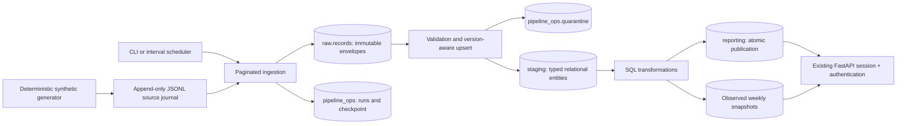

# Architecture and decisions

## Transaction boundary

A session advisory lock covers one source and all pipeline schemas in a database. Migration uses
the same lock. A run row is committed before processing. One database transaction contains raw
inserts, validation results, staging upserts, reporting refresh, snapshot insert, successful run
status, and checkpoint update. The checkpoint advances last and commits with the reports. Any
exception rolls that transaction back; a separate write marks the run failed. A process crash can
leave `running` metadata but cannot leave half-published tables. The next lock holder marks these
rows `failed/interrupted`. If the database is down, status recovery waits for the next connection.

Partial runs commit raw/quarantine/staging and their status but do not publish or advance the cursor.
Any unresolved quarantine entry blocks publication, including during unrelated backfills. That
tradeoff favors complete reporting over freshest reporting. Operators can inspect and acknowledge
discarded deliveries explicitly; the pipeline never silently acknowledges invalid records.

Reporting refresh uses DELETE/INSERT inside the transaction. PostgreSQL MVCC readers see the prior
complete result until commit. A single SQL statement has a consistent snapshot; backend aggregate
routes use one statement. Consumers making multiple queries should use a REPEATABLE READ transaction
or check publication run IDs before and after reading.

## Source and version semantics

The source cursor is a strictly contiguous arrival sequence, so timestamps can arrive arbitrarily
late without a lookback window. Each unique sequence is immutable and stores a content fingerprint.
Duplicate retransmissions of the same envelope are collapsed; distinct delivery sequences carrying
identical records remain separate raw rows but produce one staging entity. Older `updated_at`
versions never overwrite newer state; equal versions must have equal canonical content. UUID,
UTC timestamp, and decimal representations are normalized for that comparison. Creation times
and relationships cannot change for an existing entity.

The source file is frozen in memory before extraction. Pagination therefore has a stable view.
Source prefix fingerprints are rechecked against retained raw history, including partial/backfill
history. Truncation, changed envelopes, gaps, or reordered new sequences fail safely. The generator
writes files using an atomic rename. A bounded three-attempt retry covers transient file access,
database connection acquisition, transaction serialization failures, and deadlocks. Validation
and contract errors are not retried. A lost active database session aborts the run and releases its
lock; the next scheduled run handles recovery. Retry counts in a run refer to transaction attempts,
not the separately bounded source/connection acquisition attempts.

## Why these tools

- PostgreSQL provides transactions, foreign keys, exact decimal arithmetic, SQL windows, and locks
  without a separate coordination service.
- A small synchronous Python worker uses psycopg and Pydantic; the backend keeps its async
  SQLAlchemy conventions. It does not need to run inside request handlers.
- Versioned SQL migrations own only pipeline schemas and maintain a separate checksummed ledger.
  They cannot change or compete with the application's Alembic head.
- A foreground interval scheduler has no broker requirement. Existing Celery could trigger the
  CLI later if shared operational scheduling becomes useful. A five-minute interval is a local
  default, not a freshness SLA derived from observed business requirements.
- SQL reporting tables keep backend queries simple. Rebuilding small reports is easier to reason
  about than incremental aggregate repair; growing data would justify batching, partitioning, and
  incremental models after measurement.
- Weekly observations are immutable. Corrections affect current reports but do not rewrite what
  was observed earlier. Historical re-statements would require a separate, explicitly labeled model.

## Limitations

No claim of production throughput, availability, tenant isolation, or business impact is made.
The local PostgreSQL service uses synthetic development credentials. A deployment needs its own
credential/backup/retention policies. A real source adapter needs durable pagination/cursor semantics
and tombstones before source deletions can be reflected. Neither absence from a full replay nor
missing history means a deletion or a historical state. Unobserved weeks remain absent.
